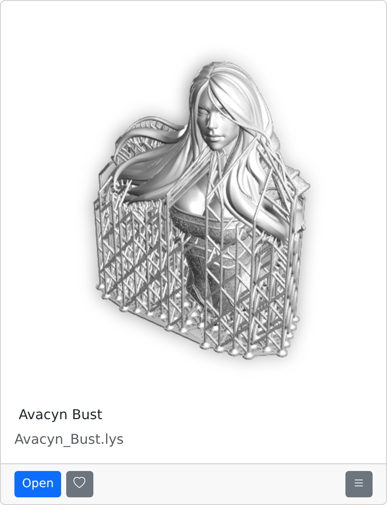

# Manyfold thumbnails

Generate thumbnails for design files in Manyfold by invoking [Catwalk3D](https://github.com/cmeister2/catwalk3d). Manyfold stores the image as its normal `render` derivative and displays it on file pages and model cards when that file is selected as the preview. Source files are preserved.

The plugin requires **Manyfold 0.151.0 or newer**. It downloads the [configured Catwalk release](config/catwalk.json) from GitHub for Linux x86_64 or ARM64 when an enabled file first needs a thumbnail. It uses Catwalk's published release metadata to verify the archive and extracted files, then caches the metadata and executable for later thumbnails. Rendering runs locally on the CPU, without a display server, GPU, CAD installation, or external rendering service.

## Examples

These are screenshots of Manyfold 0.151.0's model cards, including the model title, filename and action buttons. They display the existing Catwalk thumbnails: the Lychee render was supplied from a Manyfold library, Inventor and Fusion use authored saved-preview fixtures, and LightBurn renders project geometry.

<p align="center">
  
  
</p>

<p align="center">
  
  
</p>

<p align="center">
  
  
</p>

See [example sources and credits](docs/examples/README.md).

## Browser demo

The [GitHub Pages demo](https://cmeister2.github.io/manyfold_thumbnails/) shows real Manyfold model cards and the plugin's format-settings page. Its gallery includes saved previews, LightBurn drawings and native Inventor and Fusion geometry. Explore the format checkboxes to see which provider would be selected and which built-in providers Catwalk would override.

The demo displays pre-rendered thumbnails. Checkbox changes apply only to its own display; saving settings, uploading files and generating thumbnails require a running Manyfold installation.

Build and try the static site locally:

```sh
npm ci --ignore-scripts
npm run build:demo
node test/demo/serve.mjs dist/demo
```

Open <http://localhost:4174/manyfold_thumbnails/>. Docker exports the real pages from a disposable Manyfold 0.151.0 instance. The generated site in `dist/demo` runs without Manyfold or a database.

Run `npx playwright install chromium` and `npm run test:demo` to check the demo in Chromium. The GitHub Pages workflow builds and tests pull requests, then publishes the tested site when changes reach `main`.

## Supported files

See [Catwalk3D's format coverage](https://github.com/cmeister2/catwalk3d/blob/main/docs/format-coverage.md) for the supported file formats, saved-preview and geometry capabilities, and reader limitations. The plugin's **Thumbnail settings** page shows the formats registered for the [configured Catwalk release](config/catwalk.json), as defined in [the plugin's format registry](lib/manyfold_thumbnails/formats.rb). Catwalk's documentation tracks its latest development version; availability in this plugin depends on its configured release and registry.

Ordinary image thumbnails, including TIFF stacks, use Manyfold's image handling. TerraScan `.bin` is excluded because Manyfold uses a generic document MIME type for that extension. Fusion `.f3z` and Lychee `.lyt` are not supported by this plugin. The plugin's fixtures exercise a subset of Catwalk's readers, rather than every file variant.

Catwalk produces a PNG with a transparent background at the **3D Renders Resolution** selected in Manyfold's **Settings → File Derivatives** (Manyfold 0.153.0 or newer), including both geometry renders and saved previews. The default is 512 x 512; older Manyfold versions always use that size. Resolution changes apply to future thumbnails, backfill of missing thumbnails and explicit regeneration; existing thumbnails are retained.

Catwalk uses a fixed camera: its normal camera uses an isometric Z-up view; LightBurn uses the XY plane. Manyfold's per-file up-direction setting does not change that camera. Saved images can be missing, blank, or out of date, and file variants unsupported by a reader may still have no thumbnail. A thumbnail does not verify the design's geometry.

Inventor and Fusion geometry fallback reads stored native bodies and supported placements. It does not replay CAD feature history. Unsupported document versions, design history and assembly features may still have no thumbnail; see [Catwalk's native geometry examples and limits](https://github.com/cmeister2/catwalk3d/blob/main/docs/native-autodesk/README.md).

Inventor assemblies that need geometry fallback are given a temporary project containing their current attachment and the same model's native `.ipt` / `.iam` attachments. Filenames and relative directories are preserved, including on object storage; Catwalk resolves and decodes all references. Companion staging is limited to 128 documents and 256 MiB in total and shares the 60-second processing deadline. References above the primary assembly's directory, missing components and ambiguous filenames remain unsupported. A usable saved thumbnail does not require companion staging.

Relative sidecar resources, such as OBJ materials, glTF buffers or SolidWorks assembly components, can be read when Manyfold supplies the original local path with its extension. Downloaded or extensionless sources are processed as isolated temporary files; object-storage downloads may therefore lack sidecars. Companion staging is currently limited to Inventor assemblies. Use self-contained files when those resources are needed.

By default, Catwalk handles only formats without another thumbnail provider in the running Manyfold installation. Manyfold's F3D renderer and FreeCAD saved-preview extraction remain selected for their supported types. Enabled Catwalk formats use priority 5, above Manyfold's default model thumbnail providers. The host selects one provider per MIME type; it does not try another provider after an empty result.

## Install and use

1. Run Manyfold 0.151.0 or newer.
2. Download `manyfold_thumbnails.zip` from a release, or [build it locally](#development).
3. Upload the ZIP under **Settings > Plugins**, then restart web and worker processes. Keep the ZIP filename unchanged when updating.
4. Enable Manyfold's **Generate model renders** setting.

Newly processed enabled files receive Catwalk thumbnails when their reader can produce an image. Installation leaves the render setting unchanged. That shared setting also enables Manyfold's other model thumbnail providers.

Administrators can open **Thumbnail settings** from **Settings → Plugins**. The format table shows every supported extension, its existing Manyfold provider, the current provider, and an **Enable Catwalk** checkbox. Extensions that share a provider are configured together. Check a core-supported type to override its provider with Catwalk, or uncheck a gap type to disable its thumbnails. The page also lists active overrides. FreeCAD is left on core by default; enabling it opts into Catwalk's saved-preview and geometry support.

Settings are stored in Manyfold's database and apply to web and worker processes without restarting them. Changes affect future processing, backfill and explicit regeneration; they do not replace existing thumbnails. The plugin generates all of its thumbnails through Catwalk, including Inventor saved previews.

Catwalk is cached under `.cache/manyfold_thumbnails` in Manyfold's persistent plugins directory, with separate folders for each release and architecture. Web and worker processes can share this cache; concurrent downloads are locked and completed installations are published atomically. Set `MANYFOLD_THUMBNAILS_CATWALK_CACHE` to a writable persistent directory if the plugins volume is read-only. Its filesystem must permit execution. The development Compose setup uses `/config/catwalk`.

The first download requires access to GitHub. Startup and the settings page do not download anything. If the download fails, thumbnail generation records the failure while retaining the source and any previous render; retry when connectivity is restored. An existing verified cache works offline.

To use a separately installed Catwalk executable, set `MANYFOLD_THUMBNAILS_CATWALK` to its absolute path in both web and worker environments. This bypasses downloading and remains available for offline installations and other platforms. Automatic downloads support Linux x86_64 and ARM64.

## Existing files and regeneration

Run these tasks inside the Manyfold application with the plugin loaded. With the development Compose setup, prefix commands with `docker compose exec manyfold`.

```sh
# Queue missing thumbnails for enabled Catwalk formats across all libraries.
bundle exec rake manyfold_thumbnails:backfill

# Or scope the run to library 12.
bundle exec rake 'manyfold_thumbnails:backfill[12]'

# Inspect all runs, or run 3 and its per-file outcomes.
bundle exec rake manyfold_thumbnails:status
bundle exec rake 'manyfold_thumbnails:status[3]'

# Resume an interrupted or paused run.
bundle exec rake 'manyfold_thumbnails:resume[3]'

# Deliberately replace file 42's render.
bundle exec rake 'manyfold_thumbnails:regenerate[42]'
```

Backfill covers enabled Catwalk extensions, including files indexed before their types were registered. Core-supported formats are excluded unless Catwalk is explicitly enabled for them. It processes one file at a time and persists scanned, generated, missing-image, skipped, and failed counts with diagnostic reasons. Existing usable renders are skipped, and successful files are not processed again when a run resumes. Model renders must be enabled when queuing and processing work.

Successful generation lets Manyfold select a preview for a model that has none. Existing preview selections and collection covers are preserved. Use this task explicitly for existing files after installation; uploading the plugin does not queue a backfill.

To choose a generated thumbnail manually, edit the model and select its file in the **Preview file** field.

Regeneration replaces only the selected file's `render` derivative and preserves unrelated derivatives. Generation or persistence failures retain a previous usable render. Normal cached-upload promotion refreshes the render when replacing an attachment. Editing a source in place requires explicit regeneration. Successful regeneration also refreshes the file-page cache. Removing the plugin and restarting restores core handler selection; stored derivatives remain available.

## Processing limits

| Catwalk limit | Value |
| --- | ---: |
| Main source file | 512 MiB |
| Downloaded release archive | 64 MiB |
| Extracted release files | 128 MiB |
| Download, verification and cache-lock deadline | 120 seconds |
| Processing deadline, including local source copies and assembly staging | 60 seconds |
| Staged Inventor project | 128 documents / 256 MiB |
| PNG output | 8 MiB up to 512 x 512, plus 4 bytes per additional pixel (23 MiB at 2048 x 2048) |
| Captured diagnostics | 64 KiB |

The deadline terminates the Catwalk process when exceeded. Initial source downloads and derivative uploads occur through Manyfold outside that deadline. Assembly companion downloads are included in the processing deadline. These bounds do not establish a peak-memory limit or a limit on the total size of local sidecar resources. Missing previews and failed readers are recorded without changing the source file.

## Development

Build a ZIP with an explicit plugin version; packaging does not download Catwalk:

```sh
python3 bin/package 0.2.0
```

The archive is written to `dist/manyfold_thumbnails.zip`; the source gemspec version is unchanged. It contains the plugin code and Catwalk version configuration. The downloaded Catwalk cache retains its upstream license notices.

Renovate tracks Catwalk's GitHub releases and updates the version in `config/catwalk.json`. Download URLs and checksums come from that version's published metadata, so no checksum pins need updating in this repository. Catwalk updates use separate `fix` commits so merging them publishes a plugin release.

Run `bin/test` with Python 3 and Docker to check downloads, thumbnail dispatch, settings, workers, backfill and a packaged ZIP in disposable Manyfold containers. Test assets are downloaded separately into ignored `test/vendor/catwalk` storage and mounted into network-isolated test containers; they are never included in the plugin ZIP.

CI runs `bin/check-catwalk-formats` against the verified pinned executable's `--list-formats --json` catalog, checks its schema and Catwalk version, and requires every upstream extension to appear in either `CATWALK_EXTENSIONS` or the explicit `CATWALK_EXCLUDED_EXTENSIONS` list. Added, removed or renamed extensions fail the check, including on Renovate updates, until the registered formats and exclusions are reviewed.

Start the development instance with `docker compose up --build -d`, then open <http://localhost:3215>. After code changes, restart it with `docker compose restart manyfold`.

Releases use Conventional Commits and tags named `X.Y.Z`. The original template HEAD is tagged `0.0.0`, so the first thumbnail feature commit releases as `0.1.0`. Earlier Cults3D release tags are preserved locally as `template-vX.Y.Z` and are not published as thumbnail versions. Release analysis and notes exclude history inherited from the earlier Cults3D plugin. Release tooling requires Node 24.15 or newer:

```sh
npm ci --ignore-scripts
npm run test:release
npm run release:dry-run
```

Release previews inspect committed changes in disposable local Git repositories and publish nothing. Uncommitted working-tree changes are not included in the preview.
